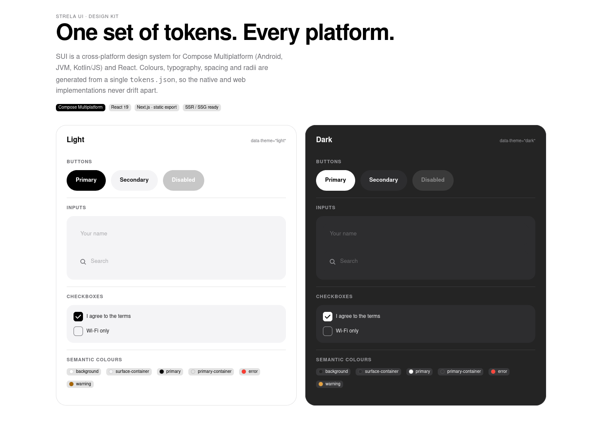
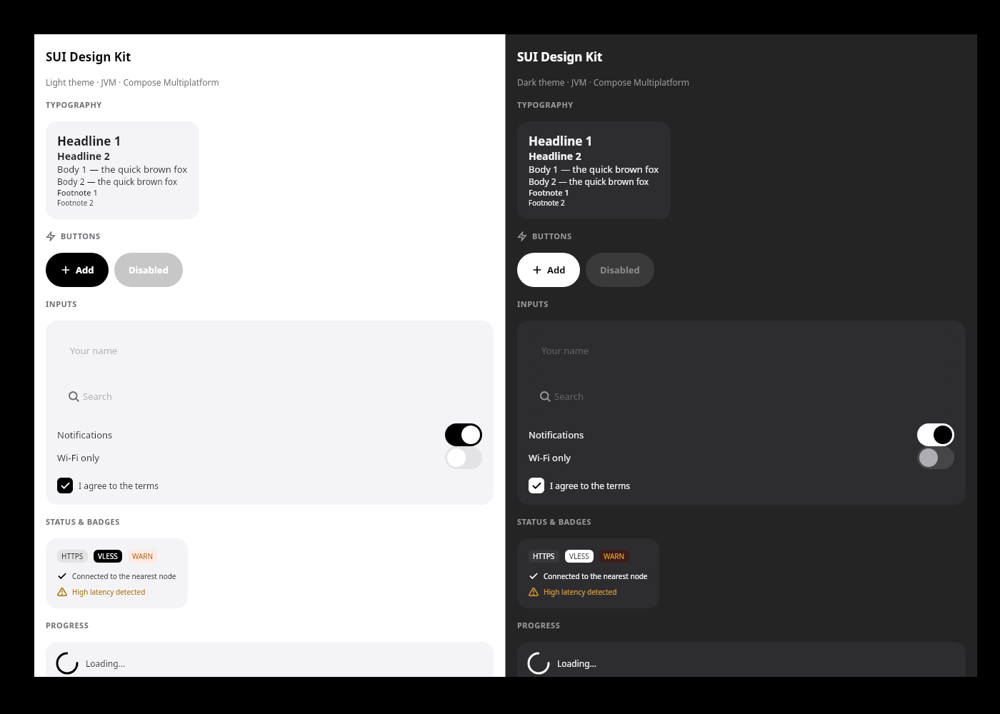

# SUI — Strela UI

Cross-platform design kit with one source of truth for design tokens. Ships a
Kotlin Multiplatform library for **Compose Multiplatform** and a **React**
component library that consumes the same CSS custom properties.

React demo — light and dark themes:



Compose Multiplatform desktop demo (JVM):



## Stack

| Layer | Technology |
| --- | --- |
| Native UI | Kotlin Multiplatform + Compose Multiplatform |
| Targets | `androidTarget` (Android-KMP library plugin), `jvm` (desktop), `js(IR)` (Kotlin/JS) |
| Tokens | `tokens/tokens.json` → generated Kotlin, CSS and TypeScript |
| Web UI | React 19 + Next.js 16 (App Router, static export / SSG) |
| Styling | CSS custom properties (`--sui-*`) + CSS Modules |
| Build | Gradle 9.6, Kotlin 2.3.20, AGP 9.4.1, Compose 1.10.3 |

The kit has no dependencies on OneBox modules. Localisation is a slot
(`LocalStrings`), so applications provide their own strings.

## Quick start

### Compose Multiplatform

```bash
./gradlew build          # compiles android, jvm and js targets
./gradlew :demo:run      # desktop demo with light + dark themes
```

> The Android target needs `ANDROID_HOME` / `local.properties` pointing at an
> installed Android SDK (API 37).

### React / Next.js

```bash
cd web
npm install
npm run dev              # http://localhost:3000
npm run build            # static SSR/SSG output in web/out
npm run preview          # serve the exported site
```

### Regenerate tokens

```bash
node scripts/generate-tokens.mjs
```

The script reads `tokens/tokens.json` and writes:

- `kit/src/commonMain/kotlin/com/strela/sui/tokens/GeneratedTokens.kt`
- `web/src/styles/tokens.css`
- `web/src/generated/tokens.ts`

Never edit the generated files by hand.

## Project structure

```
.
├── kit/                     Kotlin Multiplatform design kit
│   └── src/
│       ├── commonMain/      all components, theme, tokens
│       ├── androidMain/     Android actuals
│       ├── jvmMain/         JVM actuals
│       └── jsMain/          Kotlin/JS actuals
├── demo/                    Compose desktop demo (light + dark side by side)
├── web/                     Next.js demo, SSR/SSG, token-styled components
├── tokens/tokens.json       single source of truth for design tokens
├── scripts/generate-tokens.mjs
└── docs/                    screenshots and migration notes
```

## Compose API

```kotlin
SuiTheme(darkTheme = isSystemInDarkTheme()) {
    Card {
        Text("Hello", style = SuiTheme.textStyles.body1)

        Button(onClick = {}) {
            Text("Continue", style = SuiTheme.textStyles.button)
        }

        Checkbox(checked = agreed, onCheckedChange = { agreed = it })
    }
}
```

Available components: `Button`, `IconButton`, `Icon`, `Text`, `TextField`,
`Checkbox`, `Switch`, `Card`, `Surface`, `Scaffold`, `SmallTopAppBar`,
`NavigationBar`, `SuiDialog`, `Badge`, `SectionTitle`, `IconTile`,
`InlineMessage`, `DropdownRow`, `HorizontalDivider`, `CircularProgressIndicator`,
`LinearProgressIndicator`, `InfiniteProgressIndicator`, and the `SuiIcons` set.

Token access: `SuiTokens.lightColors`, `SuiTokens.darkColors`,
`SuiTokens.textStyles(scale)`, `SuiTokens.spacing`, `SuiTokens.radius`.

## React API

```tsx
import { Button } from "@/components/Button";
import { Input } from "@/components/Input";
import { Checkbox } from "@/components/Checkbox";

<section data-theme="dark">
  <Input placeholder="Your name" />
  <Checkbox id="terms" label="I agree to the terms" />
  <Button>Continue</Button>
</section>
```

Theme switching is a single attribute: `data-theme="light"` or
`data-theme="dark"`. The demo page renders both themes at once and is fully
pre-rendered at build time (SEO-friendly, no client JS needed for content).

## Migration notes

The module was extracted from OneBox's `:kit` module. See
[`docs/dependency-audit.md`](docs/dependency-audit.md) for the dependency audit
and the changes that removed `:core-i18n` from the build.

## License

MIT — see [LICENSE](LICENSE).
